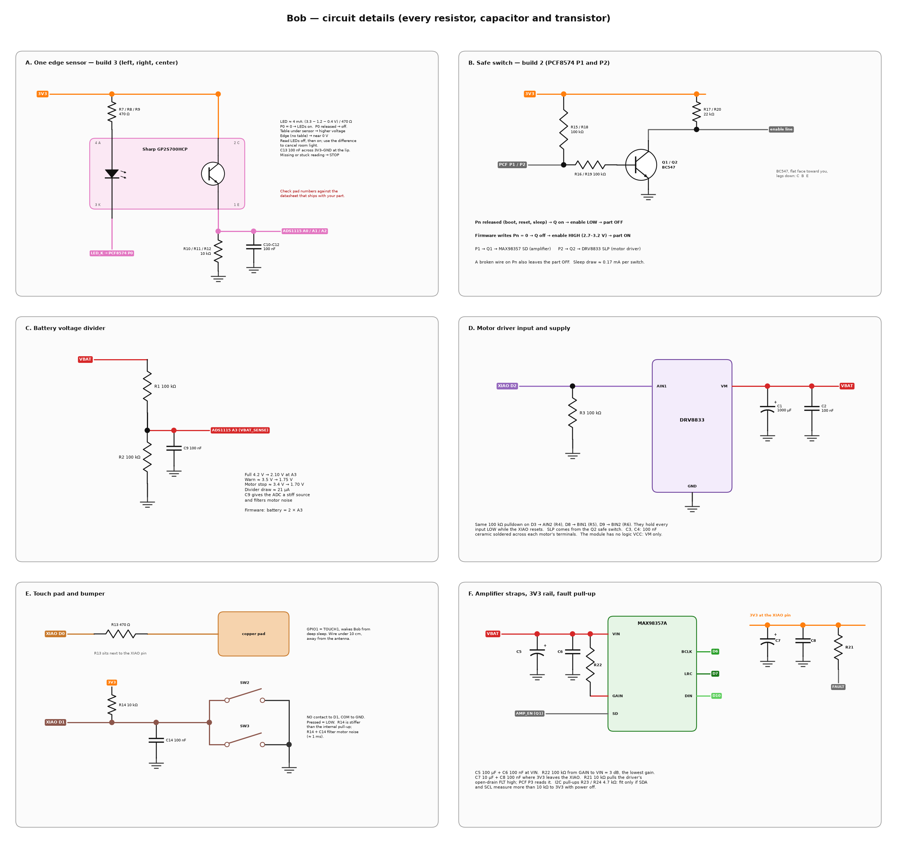
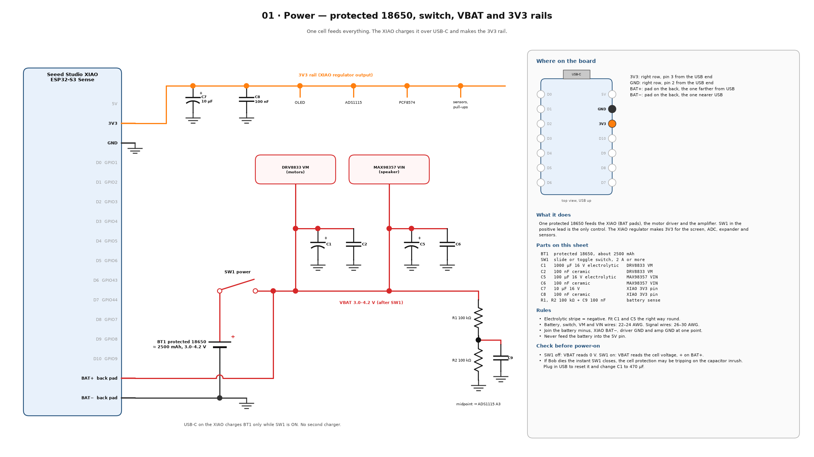
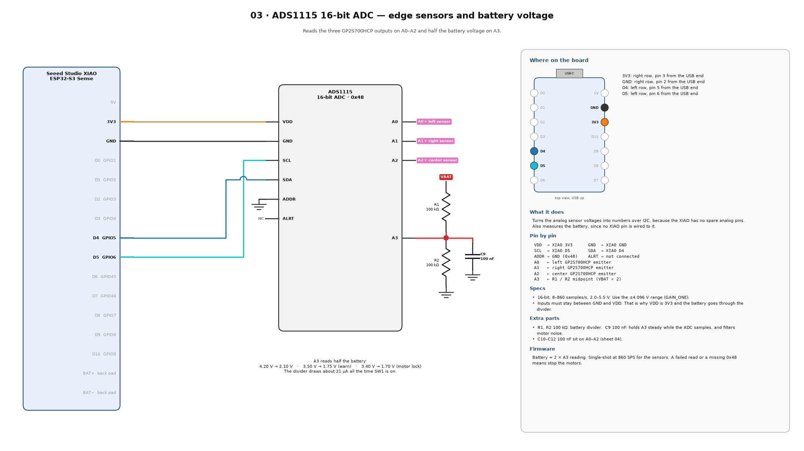
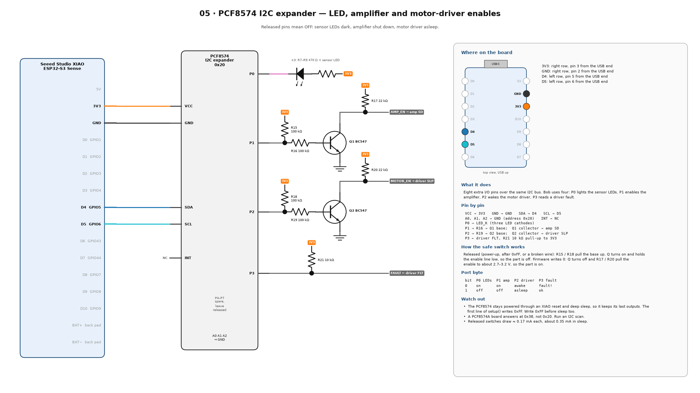
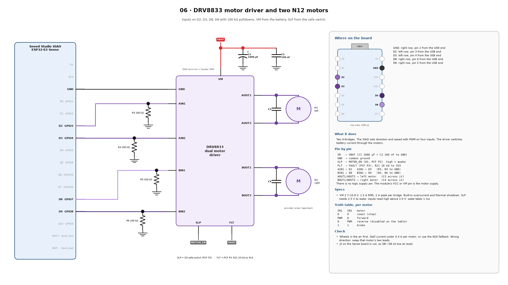
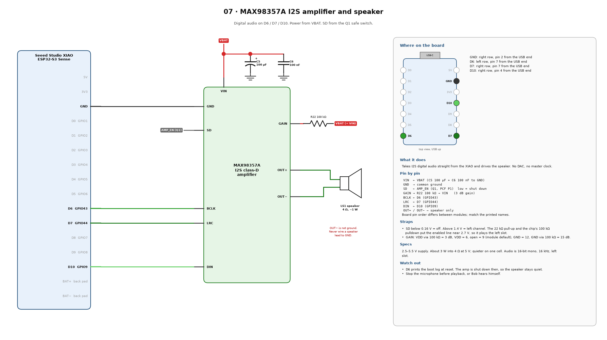
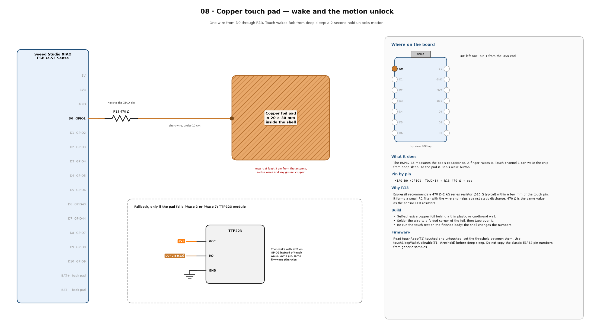
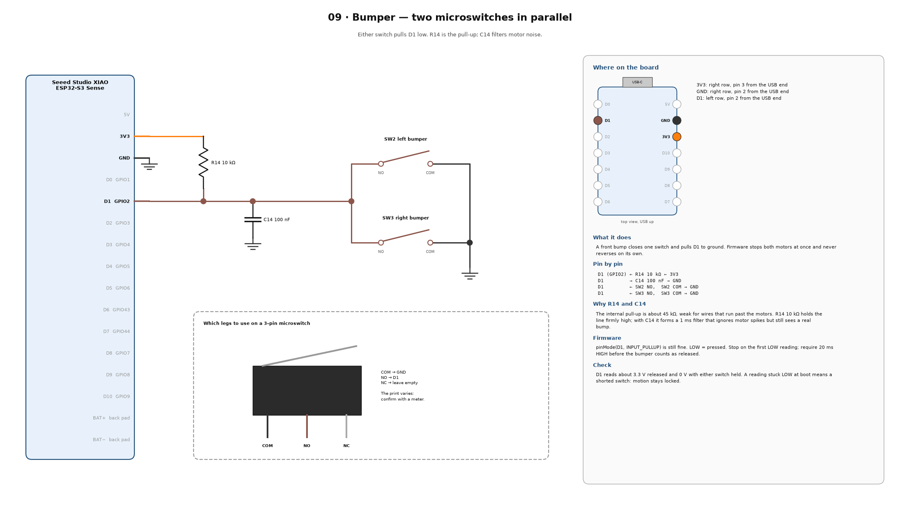

# Bob — pin diagram

Every wire below goes to the Seeed Studio XIAO ESP32-S3 Sense. The laptop can ask Bob to patrol. The XIAO is the only board that turns the motors on, and it stops them when a safety check fails.

Leave D11 and D12 on the built-in microphone. Leave the camera connector alone. Leave the microSD socket empty, and cut jumper J3 on the Sense board (see below).

## What changed in this revision

| Change | Why |
| --- | --- |
| Left motor moved from D6 / D7 to D2 / D3. Speaker BCLK / LRC moved from D2 / D3 to D6 / D7. | D6 and D7 are GPIO43 / GPIO44, the UART0 pins. They have internal pull-ups at reset and D6 prints the boot log. The PCF8574 keeps the driver awake through an XIAO reset, so a reset during a move could twitch the left wheel. D2 and D3 float at reset and the 100 kΩ pulldowns hold them low. |
| Cut J3 on the Sense board. | J3 connects the microSD pull-ups to D8, D9 and D10. They would pull the right-motor inputs high. |
| DRV8833 logic wire to 3V3 removed. | The DRV8833 has no logic supply pin. The module's VCC / VM pin is the motor supply. |
| 2N7000 removed. PCF8574 P0 sinks the three sensor LEDs directly. | The 2N7000 gate threshold can be as high as 3 V, too close to 3.3 V. The PCF8574 sinks 25 mA per pin, and a released pin already means LEDs off. |
| Safe switches are now 2 (amp, driver), with 100 kΩ / 100 kΩ / 22 kΩ. | About 0.17 mA each in sleep instead of about 0.46 mA. |
| New parts: R13 touch resistor, R14 + C14 bumper pull-up and filter, R21 fault pull-up, R22 amp gain, C2–C14 filter and decoupling capacitors. | See the part list at the end of this file. |
| DRV8833 FLT goes to PCF8574 P3. | Firmware can see an overcurrent or overheat trip. |

## Circuit images

**Figure 1 — every part wired to the XIAO**


**Figure 2 — every resistor, capacitor and transistor, by block**



### One sheet per part

Each sheet shows the XIAO pins that part uses, every extra resistor and capacitor on those wires, where the pins are on the board, and the checks to do before power-on.

| Sheet | Part |
| --- | --- |
| [00](images/parts/00-xiao-pinout.png) | XIAO ESP32-S3 Sense: what every pin does |
| [01](images/parts/01-power.png) | Protected 18650, power switch, VBAT and 3V3 rails |
| [02](images/parts/02-oled.png) | 0.96″ SSD1306 OLED |
| [03](images/parts/03-ads1115.png) | ADS1115 ADC and battery divider |
| [04](images/parts/04-edge-sensors.png) | Three GP2S700HCP edge sensors |
| [05](images/parts/05-pcf8574.png) | PCF8574 expander and the two safe switches |
| [06](images/parts/06-drv8833-motors.png) | DRV8833 driver and the two motors |
| [07](images/parts/07-max98357-speaker.png) | MAX98357A amplifier and speaker |
| [08](images/parts/08-touch-pad.png) | Copper touch pad |
| [09](images/parts/09-bumper.png) | Bumper microswitches |


















To redraw every image after a change: `.venv\Scripts\python tools\draw_circuit.py`

## Full connection

```
                         USB-C (program and charge)
                                |
                    +-----------+-----------+
                    |   XIAO ESP32-S3 Sense |
                    |   camera + microphone |
                    +-----------+-----------+
                    BAT-                 BAT+
                     |                    |
                     |               [SW1 POWER]
                     |                    |
Protected 18650 -----+--------------------+---- switched battery (VBAT)
   negative                              positive

VBAT ---- DRV8833 VM ---- C1 1000 µF + C2 100 nF ---- GND
VBAT ---- MAX98357 VIN -- C5 100 µF  + C6 100 nF ---- GND
VBAT ---- R1 100 kΩ ---- A3 midpoint ---- R2 100 kΩ ---- GND
                              +---- C9 100 nF ---- GND

XIAO 3.3 V ---- C7 10 µF + C8 100 nF ---- GND   (at the XIAO pin)
            ---- OLED VCC
            ---- ADS1115 VDD
            ---- PCF8574 VCC
            ---- three sensor LED anodes, each through 470 Ω
            ---- three sensor collectors, C13 100 nF on the sensor lip
            ---- pull-ups R14, R15, R17, R18, R20, R21

XIAO GND ---- battery negative, driver, amp, OLED, ADC, expander, sensors
```

Battery negative on the XIAO is the pad closer to the USB socket. Positive is the pad farther from USB. Check both pads with a meter before soldering.

## XIAO pins

| XIAO | GPIO | Wire | Extra parts on this wire |
| --- | --- | --- | --- |
| D0 | GPIO1 | Copper touch pad. Wake from sleep. | R13 470 Ω in series, next to the pin |
| D1 | GPIO2 | Both bumper switches. Pressed = low. | R14 10 kΩ to 3V3, C14 100 nF to GND |
| D2 | GPIO3 | DRV8833 AIN1, left motor | R3 100 kΩ to GND |
| D3 | GPIO4 | DRV8833 AIN2, left motor | R4 100 kΩ to GND |
| D4 | GPIO5 | I2C SDA | Module pull-ups; R23 4.7 kΩ only if missing |
| D5 | GPIO6 | I2C SCL | Module pull-ups; R24 4.7 kΩ only if missing |
| D6 | GPIO43 | MAX98357 BCLK | — |
| D7 | GPIO44 | MAX98357 LRC | — |
| D8 | GPIO7 | DRV8833 BIN1, right motor | R5 100 kΩ to GND |
| D9 | GPIO8 | DRV8833 BIN2, right motor | R6 100 kΩ to GND |
| D10 | GPIO9 | MAX98357 DIN | — |
| D11 | GPIO42 | Microphone clock. Do not move. | — |
| D12 | GPIO41 | Microphone data. Do not move. | — |
| 3V3 | — | Screen, ADC, expander, sensors, pull-ups | C7 10 µF + C8 100 nF to GND |
| GND | — | Common ground | — |
| 5V | — | USB power only. Do not connect the battery here. | — |

D6 (GPIO43) prints the ROM boot log at every reset. It now carries only the speaker clock, and the amplifier is shut down during boot, so the log is harmless.

D2 (GPIO3) is a strapping pin only when the `STRAP_JTAG_SEL` eFuse is burned. On a stock XIAO it is ignored, so the R3 pulldown is safe. If USB programming ever fails, unplug the D2 wire and try again.

## Sense board jumper J3

J3 is a solder bridge on the back of the Sense expansion board. It connects the microSD card's pull-up resistors to D8, D9 and D10. Bob does not use the card.

1. Cut J3 along its thin white line with a craft knife.
2. With power off, measure D8 to 3V3 and D9 to 3V3. Each should read about 100 kΩ (the R5 / R6 path), not a few kΩ.
3. Do not cut the microphone jumpers. To use the card later, bridge J3 with solder again.

## I2C bus — D4 and D5

```
XIAO D4 SDA ---- OLED SDA ---- ADS1115 SDA ---- PCF8574 SDA
XIAO D5 SCL ---- OLED SCL ---- ADS1115 SCL ---- PCF8574 SCL
XIAO 3V3    ---- OLED VCC ---- ADS1115 VDD ---- PCF8574 VCC
XIAO GND    ---- OLED GND ---- ADS1115 GND ---- PCF8574 GND
```

| Device | Address | Use |
| --- | --- | --- |
| OLED SSD1306 | 0x3C | Status screen |
| ADS1115 | 0x48 | Three edge sensors and the battery |
| PCF8574 | 0x20 | LED enable, amp enable, driver enable, driver fault |

Set the ADS1115 address pin to GND. Set the PCF8574 address pins A0, A1, and A2 to GND. A board with the PCF8574A chip answers at 0x38 instead; run an I2C scan.

Pull-ups: with power off, measure SDA to 3V3 and SCL to 3V3. Between 1.5 kΩ and 10 kΩ is fine. Above 10 kΩ, fit R23 and R24 (4.7 kΩ). Below 1.5 kΩ, remove the pull-ups on one module.

## ADS1115 inputs

| ADS pin | Signal | Extra parts |
| --- | --- | --- |
| A0 | Front-left GP2S700HCP emitter | R10 10 kΩ, C10 100 nF to GND |
| A1 | Front-right GP2S700HCP emitter | R11 10 kΩ, C11 100 nF to GND |
| A2 | Front-center GP2S700HCP emitter | R12 10 kΩ, C12 100 nF to GND |
| A3 | Battery divider midpoint | R1 / R2 100 kΩ, C9 100 nF to GND |

## One GP2S700HCP — repeat for left, right, and center

Sharp's later connection diagram labels the pads as:

| Pad | Name | Wire |
| --- | --- | --- |
| 1 | Phototransistor emitter | 10 kΩ to GND, 100 nF to GND, and to one ADS1115 input |
| 2 | Phototransistor collector | 3.3 V |
| 3 | LED cathode | LED_K line to PCF8574 P0 (all three cathodes join) |
| 4 | LED anode | 470 Ω, then 3.3 V |

```
3.3 V ---- R7 / R8 / R9 470 Ω ---- pad 4 anode
pad 3 cathode ----+---- LED_K ---- PCF8574 P0
                  |     (all three cathodes join here)

3.3 V ---- pad 2 collector
pad 1 emitter ---+---- R10 / R11 / R12 10 kΩ ---- GND
                 +---- C10 / C11 / C12 100 nF ---- GND
                 +---- ADS1115 A0 or A1 or A2

3.3 V ---- C13 100 nF ---- GND   (one, on the sensor lip)
```

LED current is about (3.3 − 1.2 − 0.4 V) / 470 Ω, so 3.5–4.5 mA each, near the datasheet's 4 mA test current. The three LEDs sink about 13 mA into P0. The PCF8574 is rated for 25 mA per pin.

Match these names to the drawing in the datasheet that comes with your parts before soldering. The package is about 4 × 3 × 2 mm, and an older sheet lists the pads in a different order.

Mount all three face-down, about 3 mm above the table, at least 25 mm in front of the wheels. Shade them from room light.

A reading near 0 V means no table. A higher reading means the table is under that sensor. The exact numbers come from a test on your desk. Read each sensor with the LEDs off, then on, and use the difference to cancel room light. Wait 5 ms after switching the LEDs, because R10 × C10 is a 1 ms filter. A missing or stuck sensor means stop.

## PCF8574 pins

| PCF pin | Wire | Released (boot, reset, sleep) | Firmware writes 0 |
| --- | --- | --- | --- |
| P0 | LED_K, three sensor LED cathodes | LEDs off | LEDs on |
| P1 | Q1 safe switch → MAX98357 SD | Amp shut down | Amp on, left channel |
| P2 | Q2 safe switch → DRV8833 SLP | Driver asleep | Driver awake |
| P3 | DRV8833 FLT, R21 10 kΩ to 3V3 | Read: 1 = OK, 0 = fault | Do not write 0 |
| P4–P7 | Spare | Leave released | — |

The PCF8574 stays powered through an XIAO reset and through deep sleep, so it keeps its last outputs. The first line of `setup()` writes 0xFF to it. Write 0xFF again before deep sleep.

## Safe switches — Q1 and Q2

Each switch uses one BC547 so the part stays off until firmware turns it on.

```
PCF pin ---- R15 / R18 100 kΩ ---- 3.3 V
        +--- R16 / R19 100 kΩ ---- BC547 base
                                   BC547 emitter ---- GND
                                   BC547 collector ---- enable wire
enable wire ---- R17 / R20 22 kΩ ---- 3.3 V
```

| Switch | PCF pin | Enable wire | Off at boot | Firmware turns it on for |
| --- | --- | --- | --- | --- |
| Q1 | P1 | MAX98357 SD | Speaker amp off | Speaking |
| Q2 | P2 | DRV8833 SLP | Motor driver asleep | A move that passed the checks |

Released: R15 / R18 pull the base up, the BC547 turns on and holds the enable wire low. Firmware writes 0: the BC547 turns off and the 22 kΩ pulls the enable wire to about 2.7 V (amp SD, against its internal 100 kΩ pulldown) or 3.2 V (driver SLP, against its internal 500 kΩ). Both are above the "on" thresholds: 1.4 V for the amp's left channel and 2.5 V for the driver. A broken wire on the PCF side also leaves the part off.

BC547 pinout, flat face toward you, legs down: collector, base, emitter.

## DRV8833 and motors

```
VBAT ---------------- DRV8833 VM ---- C1 1000 µF + C2 100 nF ---- GND
XIAO GND ------------ DRV8833 GND
XIAO D2 ------------- AIN1 ---- R3 100 kΩ ---- GND
XIAO D3 ------------- AIN2 ---- R4 100 kΩ ---- GND
XIAO D8 ------------- BIN1 ---- R5 100 kΩ ---- GND
XIAO D9 ------------- BIN2 ---- R6 100 kΩ ---- GND
Q2 safe switch ------ SLP  (nSLEEP, also printed EEP)
PCF P3 -------------- FLT  (nFAULT, also printed ULT) ---- R21 10 kΩ ---- 3.3 V

DRV8833 AOUT1 / AOUT2 --- left motor  ---- C3 100 nF across the motor terminals
DRV8833 BOUT1 / BOUT2 --- right motor ---- C4 100 nF across the motor terminals
```

The DRV8833 has no logic supply pin. On most modules the power pin is printed VCC or VM, and it is the motor supply. Do not connect 3V3 to it.

The 100 kΩ resistors hold the inputs low while the XIAO resets, so a reset cannot start a wheel. Tape the encoder wires aside. They are not connected in this version. Solder C3 and C4 (ceramic, 50 V) straight across each motor's two tabs.

| Command | D2 AIN1 | D3 AIN2 | D8 BIN1 | D9 BIN2 |
| --- | --- | --- | --- | --- |
| Stop | low | low | low | low |
| Forward | PWM | low | PWM | low |
| Pivot left | low | low | PWM | low |
| Pivot right | PWM | low | low | low |
| Reverse | — | — | — | — |

If a wheel turns the wrong way during the wheels-up test, swap that motor's two leads. Reverse stays unused on the table.

## Speaker

```
VBAT ------------- MAX98357 VIN ---- C5 100 µF + C6 100 nF ---- GND
XIAO GND --------- MAX98357 GND
XIAO D6 ---------- BCLK
XIAO D7 ---------- LRC
XIAO D10 --------- DIN
Q1 safe switch --- SD
GAIN ------------- R22 100 kΩ ---- VIN   (3 dB, the lowest gain)
OUT+ / OUT- ------ speaker
```

The two speaker wires go only to OUT+ and OUT−. Mute the microphone while the speaker plays.

## Touch and bumper

```
XIAO D0 ---- R13 470 Ω ---- short wire ---- copper foil
             (R13 next to the XIAO pin; foil must not touch GND or the antenna)

3.3 V ---- R14 10 kΩ ----+---- XIAO D1
                         +---- C14 100 nF ---- GND
                         +---- bumper switch 1 NO, COM ---- GND
                         +---- bumper switch 2 NO, COM ---- GND
Either switch closed = D1 low = bumper hit = stop
```

Espressif recommends a 470 Ω–2 kΩ series resistor on a touch pin, placed within a few millimetres of it. R14 is stiffer than the internal pull-up; with C14 it filters motor noise with about a 1 ms time constant.

## Autonomous patrol around the table

This loop runs on the XIAO. The laptop may send `start_patrol` or `stop_patrol`. It never drives D2, D3, D8, or D9 itself.

Bob creeps, stops, and looks again. One step is short. He turns away from a front corner that has lost the table. He does not reverse.

```
loop:
  read battery, bumper, driver fault, left, center, right

  stop if battery is low
  stop if the bumper is pressed
  stop if the driver fault line (PCF P3) is low
  stop if any sensor is missing or stuck
  stop if patrol is off

  if left, center, and right all see the table:
      forward for 200 ms at the speed cap
      stop

  else if left has lost the table, and center and right still see it:
      pivot right for 150 ms
      stop

  else if right has lost the table, and center and left still see it:
      pivot left for 150 ms
      stop

  else:
      stop and wait
```

Limits on every step:

- Duty at most 40%, and lower once the floor test finds about 30–40 mm/s.
- Forward step at most 200 ms during patrol.
- Pivot at most 150 ms.
- After each step, read the sensors again before the next step.
- A bumper hit, a driver fault, or a bad sensor ends the patrol until you touch the pad.

Run this only after the supervised checks: wheels in the air, then the floor, then a board with foam past the edge, then one slow trip on the real table with your hand ready. Three front sensors can miss a wheel during a turn. Stay with Bob the first times he patrols.

## Every resistor, capacitor and transistor

| Ref | Value | Type | Where |
| --- | --- | --- | --- |
| R1, R2 | 100 kΩ | ¼ W resistor | Battery divider to ADS1115 A3 |
| R3, R4, R5, R6 | 100 kΩ | ¼ W resistor | DRV8833 AIN1, AIN2, BIN1, BIN2 to GND |
| R7, R8, R9 | 470 Ω | ¼ W resistor | Sensor LED anodes to 3V3 |
| R10, R11, R12 | 10 kΩ | ¼ W resistor | Sensor emitters to GND |
| R13 | 470 Ω | ¼ W resistor | In series with the touch pad, at D0 |
| R14 | 10 kΩ | ¼ W resistor | Bumper pull-up, D1 to 3V3 |
| R15, R18 | 100 kΩ | ¼ W resistor | PCF P1 / P2 to 3V3 |
| R16, R19 | 100 kΩ | ¼ W resistor | PCF P1 / P2 to Q1 / Q2 base |
| R17, R20 | 22 kΩ | ¼ W resistor | Amp SD / driver SLP enable pull-ups |
| R21 | 10 kΩ | ¼ W resistor | DRV8833 FLT pull-up to 3V3 |
| R22 | 100 kΩ | ¼ W resistor | MAX98357 GAIN to VIN (3 dB) |
| R23, R24 | 4.7 kΩ | ¼ W resistor | I2C pull-ups, only if the modules have none |
| C1 | 1000 µF 16 V | Electrolytic | DRV8833 VM to GND |
| C2 | 100 nF | Ceramic | DRV8833 VM to GND |
| C3, C4 | 100 nF 50 V | Ceramic | Across each motor's terminals |
| C5 | 100 µF 16 V | Electrolytic | MAX98357 VIN to GND |
| C6 | 100 nF | Ceramic | MAX98357 VIN to GND |
| C7 | 10 µF 16 V | Electrolytic or ceramic | XIAO 3V3 pin to GND |
| C8 | 100 nF | Ceramic | XIAO 3V3 pin to GND |
| C9 | 100 nF | Ceramic | Battery divider midpoint to GND |
| C10, C11, C12 | 100 nF | Ceramic | ADS1115 A0, A1, A2 to GND |
| C13 | 100 nF | Ceramic | 3V3 to GND on the sensor lip |
| C14 | 100 nF | Ceramic | Bumper line D1 to GND |
| Q1, Q2 | BC547 | NPN, TO-92 | Amp and motor-driver safe switches |
