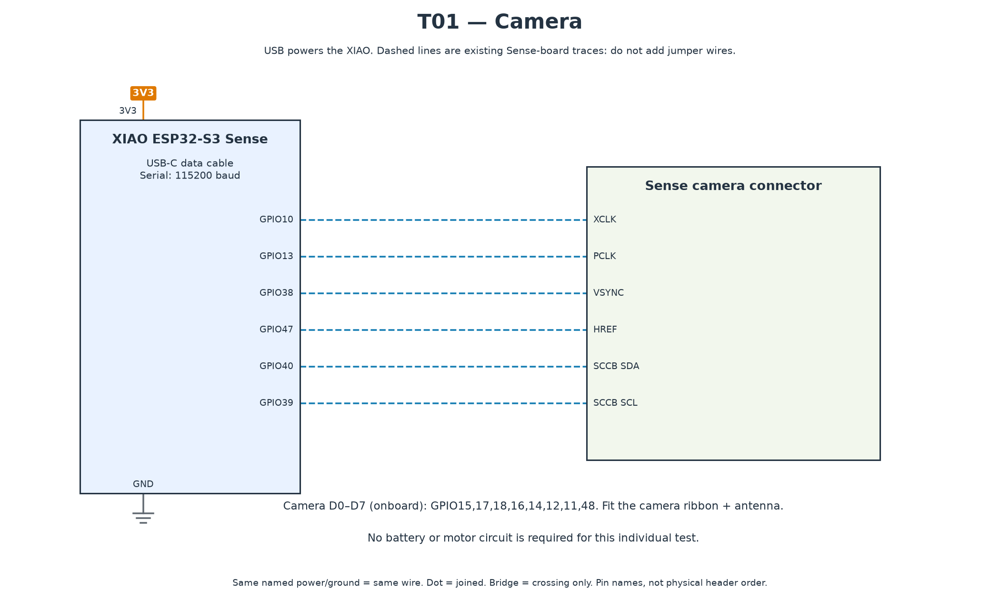

# T01 — Camera

[All hardware tests](../README.md) · [Full robot circuit](../../../docs/CIRCUIT.md)

[Full-size PNG](circuit.png) · [Zoomable SVG](circuit.svg)

**Parts:** XIAO ESP32-S3 Sense with fitted camera, antenna and USB data cable. No external sensor wiring. Dashed connections in the diagram are existing board traces.

1. Follow the [common upload settings](../README.md). Enable OPI PSRAM.
2. Optionally copy `secrets.example.h` to `secrets.h` and enter 2.4 GHz Wi-Fi details for browser viewing. Leave Wi-Fi empty for Serial-only captures.
3. Upload `T01_camera.ino`; open Serial Monitor at 115200.
4. With Wi-Fi configured, open the printed HTTP address and refresh to view a photo.

**Pass:** PSRAM found, camera PID/name printed, five nonempty JPEG captures and a recognizable browser image when Wi-Fi is enabled. Record the camera variant in the [inventory](../../../docs/INVENTORY.md). Image byte count depends on the scene.

If initialization fails, disconnect power and reseat the ribbon and Sense board. Missing PSRAM usually means the board settings are wrong.
