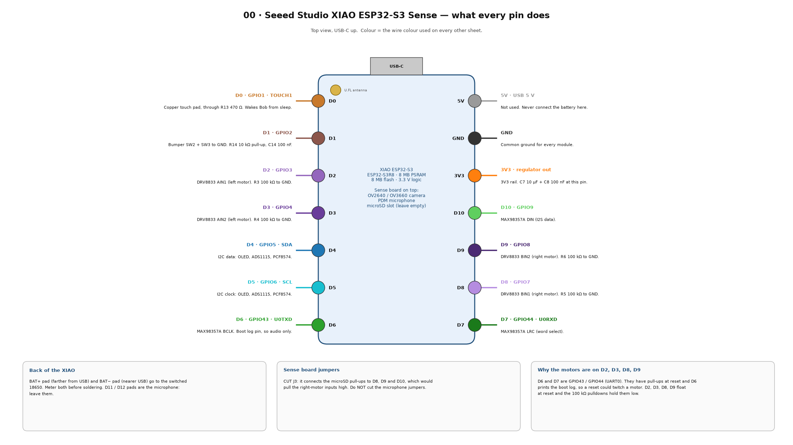

# T01 — Camera

Checks that PSRAM is on, reads the camera's name, and takes five photos. With Wi-Fi details filled in, it also shows the photo in a browser.



## Wiring

Nothing extra. The camera is on the Sense board's ribbon connector. Fit the antenna.

## Steps

1. Optional: copy `secrets.example.h` to `secrets.h` and type your Wi-Fi name and password there (2.4 GHz only). Leave both empty to skip Wi-Fi. `secrets.h` stays on this computer.
2. Tools: **XIAO_ESP32S3**, **PSRAM: OPI PSRAM**, **USB CDC On Boot: Enabled**. Upload.
3. Open Serial Monitor at 115200.
4. With Wi-Fi: open the printed address, for example `http://192.168.1.77/`, and refresh for new photos.

## Expected output

```
PSRAM: found, 8388608 bytes
Camera sensor PID 0x3660 = OV3660
Photo 1: 640x480, 21544 bytes JPEG
...
```

## Pass

- PSRAM found.
- A camera name is printed. **Write it in `BOB.md` Phase 1.**
- Five photos with a size above about 5,000 bytes. The browser photo is sharp at about 20–40 cm.

## If it fails

| Message | Fix |
| --- | --- |
| `PSRAM: MISSING` | Tools > PSRAM > OPI PSRAM, upload again. |
| `esp_camera_init error 0x105` or `0x20001` | Ribbon not seated: open the latch, push the ribbon fully in, close it. |
| Photo very dark or green | Normal for the first frame; refresh. Peel the lens film off. |
| Wi-Fi does not connect | The network must be 2.4 GHz. Antenna fitted. |
