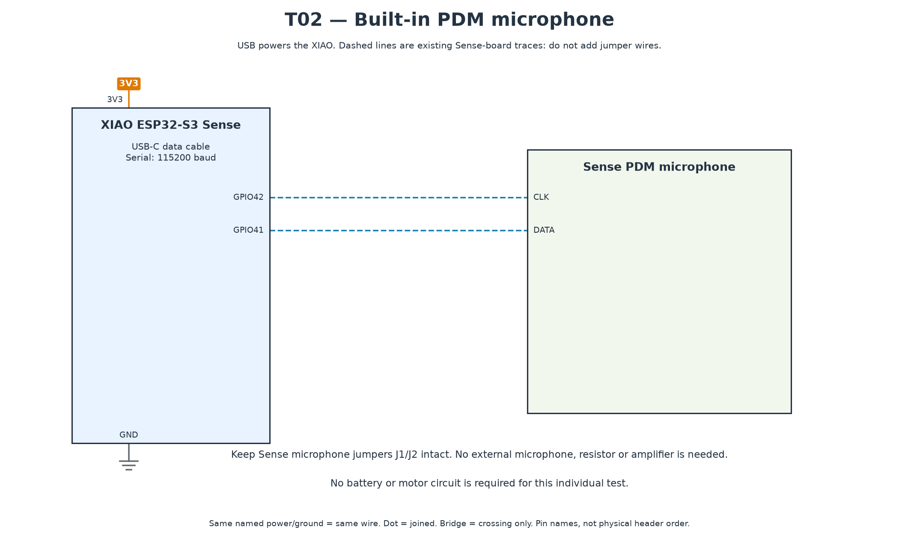

# T02 — Built-in microphone

[All hardware tests](../README.md) · [Full robot circuit](../../../docs/CIRCUIT.md)

[Full-size PNG](circuit.png) · [Zoomable SVG](circuit.svg)

**Parts:** XIAO ESP32-S3 Sense, USB cable. Keep the microphone jumpers intact; GPIO42 is clock and GPIO41 is data. No external microphone or amplifier.

1. Upload `T02_microphone.ino` using the [common settings](../README.md).
2. Open Serial Plotter at 115200. Record a quiet baseline, speak, then clap about 30 cm away.

**Pass:** speech/claps produce repeatable peaks clearly above the quiet level, without persistent clipping or silence. A clap around ten times the quiet level is a useful initial check, not a calibrated acoustic measurement.

For a flat trace, power off and check the Sense connector and microphone jumpers. Repeat later with the motors and speaker operating during full-robot commissioning.
