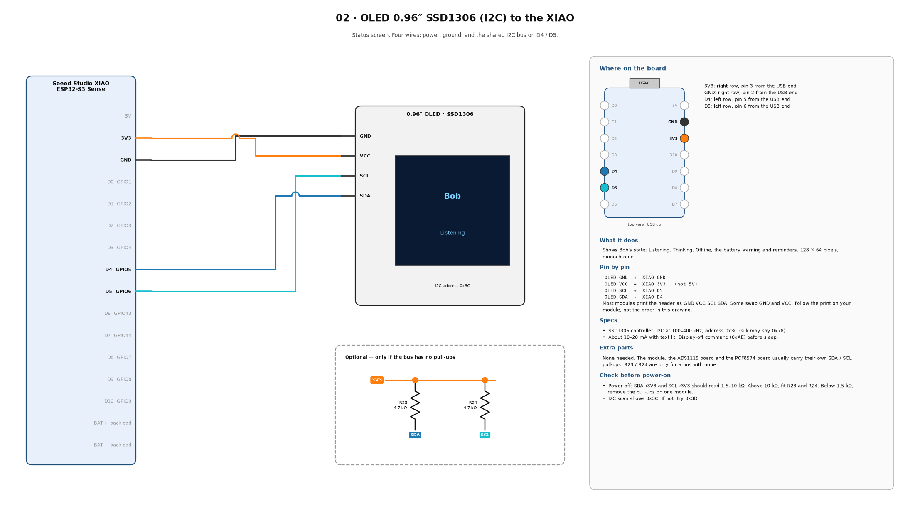

# T03 — I2C scan

Checks that SDA and SCL rest high (pull-ups present), then lists every I2C device and names Bob's three parts. Run it after wiring each I2C part.

| Part | Address | Address pins |
| --- | --- | --- |
| OLED SSD1306 | 0x3C (sometimes 0x3D) | fixed on the module |
| ADS1115 | 0x48 | ADDR to GND |
| PCF8574 | 0x20 (PCF8574A: 0x38) | A0, A1, A2 to GND |




## Wiring

All three parts share four wires: 3V3, GND, SDA to **D4**, SCL to **D5**.

Pull-ups: with power off, measure SDA to 3V3 and SCL to 3V3. 1.5–10 kΩ is fine. Above 10 kΩ, fit R23 and R24 (4.7 kΩ). Below 1.5 kΩ, remove the pull-ups from one module.

## Steps

1. Upload, open Serial Monitor at 115200.
2. Press Enter in the Serial Monitor to scan again after wiring another part.

## Expected output

```
SDA (D4) idle: high OK   SCL (D5) idle: high OK
  0x20  PCF8574 expander
  0x3C  SSD1306 OLED
  0x48  ADS1115 ADC
3 device(s).
PASS
```

## If it fails

| Symptom | Fix |
| --- | --- |
| A line reads `LOW` | Missing pull-ups, SDA/SCL shorted to GND, or a module unpowered (an unpowered module can pull the bus low). |
| Device missing | Check its 3V3 and GND, and that SDA/SCL are not swapped. |
| PCF at 0x38 | It is a PCF8574A. Change `PCF_ADDR` to 0x38 in `bob/config.h`. |
| Two devices at 0x3C | A PCF8574A with A2 high. Tie A0–A2 to GND. |
