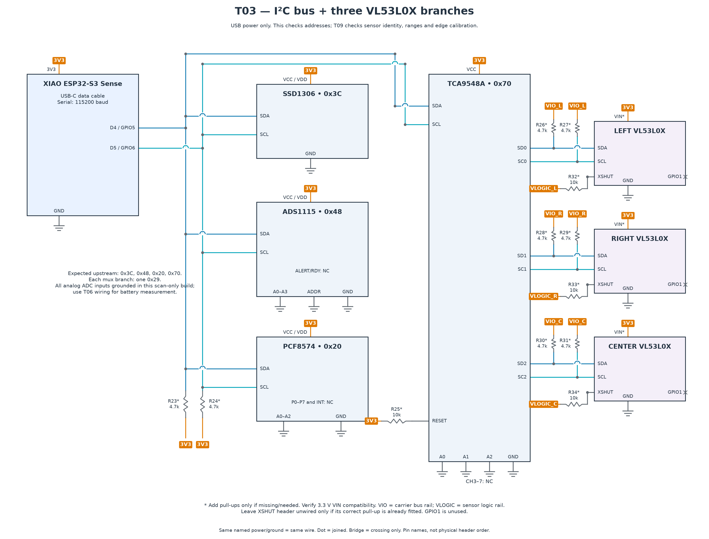

# T03 — I²C bus and three VL53L0X branches

[All hardware tests](../README.md) · [Full robot circuit](../../../docs/CIRCUIT.md)

[Full-size PNG](circuit.png) · [Zoomable SVG](circuit.svg)

**Parts:** XIAO, SSD1306, ADS1115, PCF8574, TCA9548A, three VL53L0X modules and USB cable. The diagram shows the complete scan fixture; you may connect one upstream module at a time while assembling it.

1. Wire D4/GPIO5 to SDA and D5/GPIO6 to SCL. Match module **printed pin labels**, not drawing positions.
2. Connect left/right/center VL53L0X to mux channels 0/1/2. Check your carrier's VIN/interface voltage and existing pull-ups using the [carrier notes](../../../docs/HARDWARE.md). Starred resistors are fitted only if needed. Do not assume XSHUT tolerates 3.3 V.
3. Upload `T03_i2c_scan.ino`, open Serial Monitor at 115200, press Enter to rescan.

| Location | Expected addresses with all shown parts connected |
| --- | --- |
| Upstream | OLED `0x3C`, ADC `0x48`, PCF `0x20` (some variants `0x38`), mux `0x70` |
| Mux CH0 / CH1 / CH2 | One `0x29` on each branch |

**Pass:** every fitted device acknowledges at its expected address. This proves communication only; [T09](../T09_edge_sensors/README.md) checks identity and usable ranges.

The diagram grounds ADC A0–A3 for this isolated scan fixture. For an already assembled robot, retain its battery divider on A3; do not ground that node. Use [T06](../T06_battery_adc/README.md) for battery measurements. Optional branch pull-ups use the carrier's verified bus rail (VIO); XSHUT uses its sensor logic rail (VLOGIC), which may differ.
