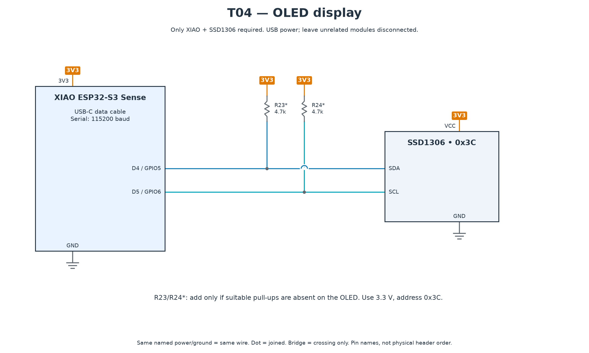

# T04 — OLED display

[All hardware tests](../README.md) · [Full robot circuit](../../../docs/CIRCUIT.md)

[Full-size PNG](circuit.png) · [Zoomable SVG](circuit.svg)

**Parts:** XIAO, SSD1306 I²C OLED, USB cable; R23/R24 only if suitable bus pull-ups are absent. VCC → 3V3, GND → GND, SDA → D4, SCL → D5.

1. Install the pinned Adafruit SSD1306/GFX libraries through the [setup instructions](../../README.md).
2. Upload `T04_oled.ino` and open Serial Monitor at 115200.

**Pass:** display detected, “Bob” and blinking eyes visible, counter increases. The project uses address `0x3C`; this diagnostic can also detect `0x3D`.

If absent, run T03 and check the four wires. If detected but blank/garbled, verify that the controller is SSD1306 rather than SH1106.
