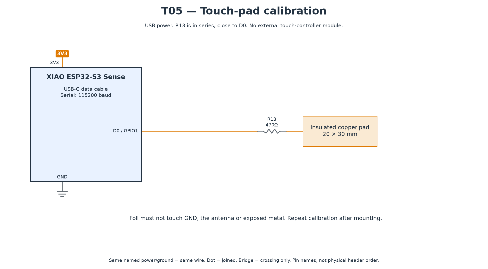

# T05 — Touch-pad calibration

[All hardware tests](../README.md) · [Full robot circuit](../../../docs/CIRCUIT.md)

[Full-size PNG](circuit.png) · [Zoomable SVG](circuit.svg)

**Parts:** XIAO, copper foil about 20 × 30 mm, R13 470 Ω, USB cable. Put R13 close to D0/GPIO1 and keep the pad lead short. Insulate the pad from grounded metal and keep it away from the antenna.

1. Upload `T05_touch.ino`, open Serial Monitor at 115200.
2. Leave the pad untouched for the first three seconds; then touch and hold it for three seconds when prompted.
3. Copy valid `TOUCH_IDLE`, `TOUCH_PRESS_DELTA` and `TOUCH_WAKE_DELTA` values into `code/bob/config.h`; copy the wake delta into T12 too.
4. Press Enter to repeat. Repeat calibration after mounting the pad in the enclosure.

**Pass:** touched readings are repeatably separated from idle (initial target ≥1.2×), and the live output says `TOUCHED` only during a touch.

If unstable, shorten/reposition the wire and keep it away from motor/speaker wiring. A digital touch-controller module is not a drop-in replacement for this capacitive-input sketch.
