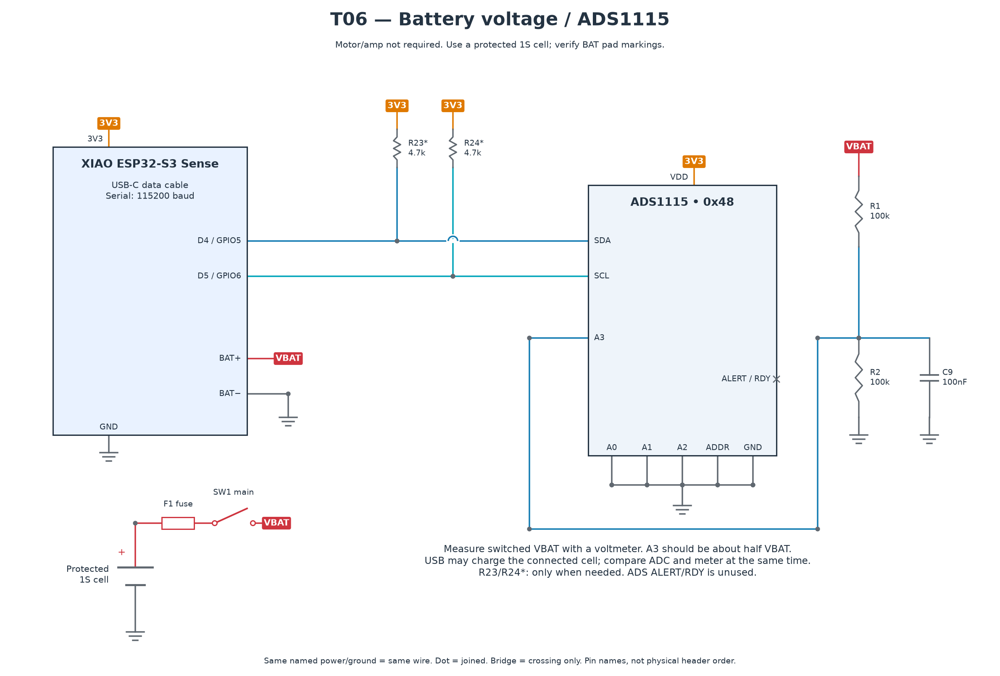

# T06 — Battery voltage and ADC

[All hardware tests](../README.md) · [Full robot circuit](../../../docs/CIRCUIT.md)

[Full-size PNG](circuit.png) · [Zoomable SVG](circuit.svg)

**Parts:** XIAO, ADS1115, R1/R2 100 kΩ each, C9 100 nF, protected 1S cell, holder, fuse F1, switch SW1, USB cable and voltmeter. Select fuse and wiring ratings from the [power checklist](../../../docs/INVENTORY.md).

1. With power removed, wire the diagram. Verify **BAT+ / BAT− markings** and battery polarity with a meter before connecting. Do not infer pad polarity from board orientation.
2. Turn SW1 on, upload `T06_battery_adc.ino`, open Serial Monitor at 115200. ADS1115 ADDR is GND (`0x48`); A3 is the divider midpoint.
3. Measure switched VBAT with a voltmeter at the same time as the ADC reading. A3 should be approximately half VBAT. USB can charge the connected cell.
4. Enter the meter voltage, e.g. `3.98`. Copy the valid `BATTERY_CAL` result into `code/bob/config.h`.

**Pass:** readings agree within 50 mV after calibration, with no timeout/invalid readings. Recheck near 4.2, 3.7 and 3.4 V during normal discharge.

For zero or doubled readings, check A3, the two resistor values and common ground. Do not connect raw VBAT directly to an ADC input or XIAO GPIO.
