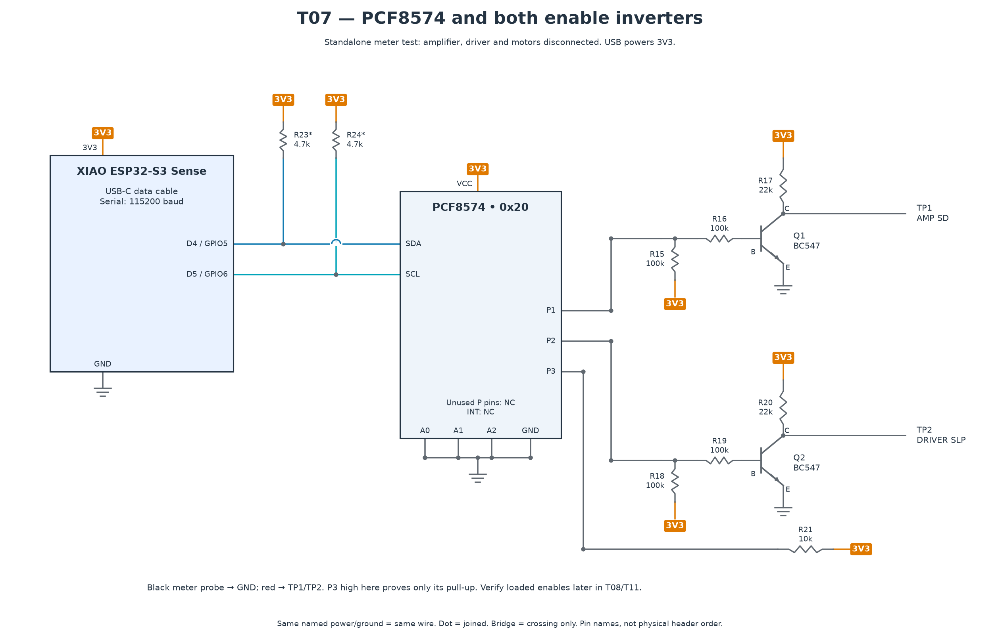

# T07 — Expander and enable transistors

[All hardware tests](../README.md) · [Full robot circuit](../../../docs/CIRCUIT.md)

[Full-size PNG](circuit.png) · [Zoomable SVG](circuit.svg)

**Parts:** XIAO, PCF8574, Q1/Q2 BC547, R15/R16/R18/R19 100 kΩ, R17/R20 22 kΩ, R21 10 kΩ, USB cable and voltmeter. Verify the actual transistor B/C/E pinout. This fixture leaves the amplifier, driver and motors disconnected.

1. Upload `T07_pcf8574.ino`; open Serial Monitor at 115200.
2. Put the black meter probe on GND. Measure TP1 and TP2: both should be near 0 V with the ports released.
3. Key `2` toggles TP1 (future amp SD); key `3` toggles TP2 (future driver nSLEEP). Each should alternate between near 0 V and near 3V3 in this unloaded fixture.
4. Key `f` reads P3; key `r` releases both enables. Reset and confirm both return low after initialization.

**Pass:** both independent inverter outputs switch correctly and release low. P3 high here proves only its pull-up; there is no driver in this fixture. Serial's approximate loaded voltages do not apply to unloaded TP1/TP2.

Repeat voltage checks with the actual loads in T08/T11. Driver nSLEEP must meet its ≥2.5 V high threshold; amplifier SD must meet the fitted module's thresholds. Check/remove conflicting carrier straps before connection. Reset behavior of the complete robot is a separate acceptance test.
