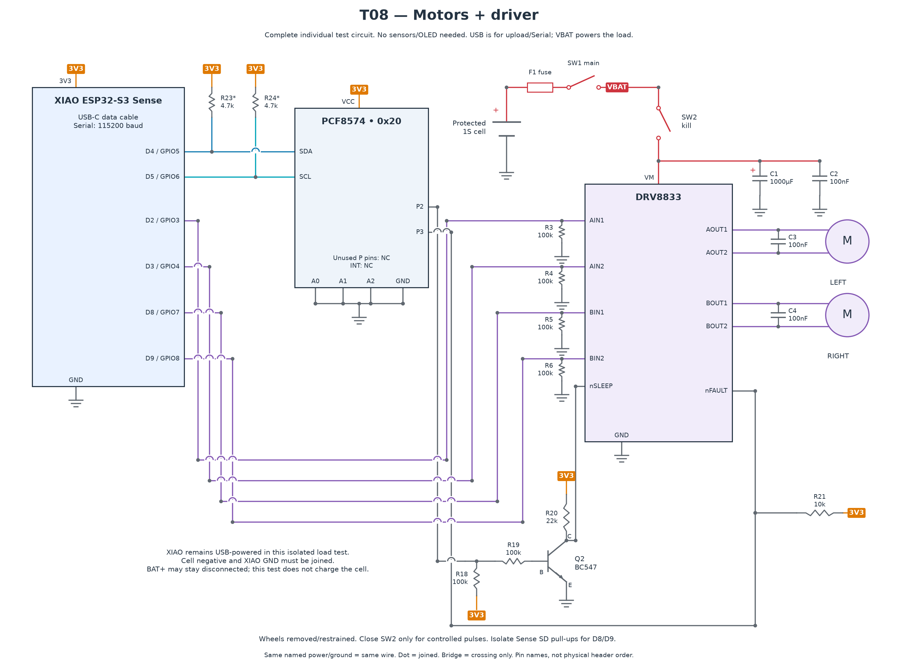

# T08 — Motors and DRV8833

[All hardware tests](../README.md) · [Full robot circuit](../../../docs/CIRCUIT.md)

[Full-size PNG](circuit.png) · [Zoomable SVG](circuit.svg)

**Parts:** XIAO, PCF8574, DRV8833, two motors, Q2 and R18–R21, R3–R6 100 kΩ, C1 1000 µF, C2–C4 100 nF, protected 1S cell, F1, SW1 and motor kill SW2. Full connections are above; T07 must pass first.

The XIAO is USB-powered in this isolated test; the cell powers VM through SW1/SW2. Join cell negative to XIAO GND. BAT+ can remain disconnected. Never power motors from 3V3. Isolate the Sense SD pull-ups affecting D8/D9 as described in [hardware](../../../docs/HARDWARE.md); leave microSD empty.

1. Disconnect power and wire the circuit. Put C1/C2 close to VM and C3/C4 across the motor terminals. Verify capacitor polarity, driver enable/fault straps and all four input pull-downs.
2. Remove the wheels or restrain the chassis with wheels clear. Keep SW2 open during upload of `T08_motors.ino`; open Serial Monitor at 115200.
3. After checking enable levels, close SW2 for controlled pulses. Test `a` then `b`; swap a motor's leads **with power off** if its forward direction is wrong.
4. Verify `x`, SW2 and reset stop the outputs. Open SW2 when finished. Characterize startup/stall current separately with a current-limited supply and the motor manufacturer's procedure; never hold a wheel at full battery power.

| Key | Action |
| --- | --- |
| `a` / `A` | Left forward / backward, 300 ms |
| `b` / `B` | Right forward / backward, 300 ms |
| `f` | Both forward, 300 ms |
| `l` / `r` | Left / right pivot, 250 ms |
| `+` / `-` | Duty ±5%; starts 30%, maximum 40% |
| `x` | Stop |
| `s` / `S` | Stall commands disabled |

**Pass:** correct directions, bounded pulses, no reset movement or faults, and measured current/temperature within the actual driver, carrier, motor, cell and wiring limits. Record measurements in [inventory](../../../docs/INVENTORY.md). A generic current target is not proof of compatibility.

If the driver faults, power off and check motor shorts/current. If the XIAO resets, inspect supply sag, contacts and capacitor placement. This diagnostic does not provide cliff protection.
