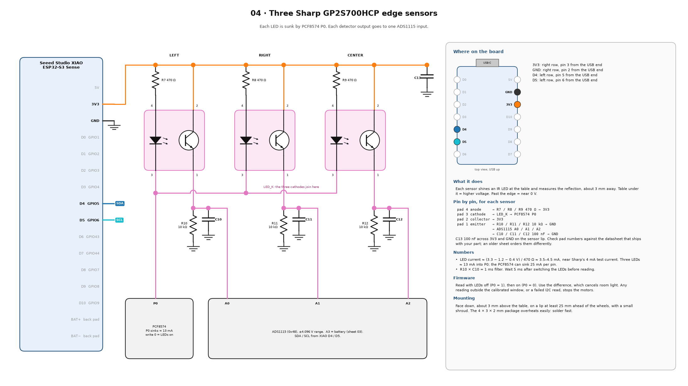

# T09 — Edge sensors

Reads the three GP2S700HCP sensors twice per sample, LEDs off and LEDs on, and uses the difference so room light cancels. Then it records your real desk and the edge, and prints the thresholds for the full firmware.



## Wiring (each of the three sensors)

```
3V3 ---- R7/R8/R9 470 Ω ---- pad 4 (LED anode)
pad 3 (LED cathode) ---- LED_K ---- PCF8574 P0   (all three cathodes join)
3V3 ---- pad 2 (collector)
pad 1 (emitter) --+-- R10/R11/R12 10 kΩ ---- GND
                  +-- C10/C11/C12 100 nF ---- GND
                  +-- ADS1115 A0 (left) / A1 (right) / A2 (center)
3V3 ---- C13 100 nF ---- GND, on the sensor lip
```

Check the pad numbers against your datasheet before soldering. Mount the sensors face-down, about 3 mm above the table, at least 25 mm in front of the wheels, with a small shade.

## Library

Adafruit ADS1X15.

## Steps

1. Upload, open **Serial Plotter** at 115200 to see `left`, `right`, `center`.
2. Hold the body (or the sensor stick) on your real desk at the normal height. Open Serial Monitor and press `d`. Hold still for 2 s.
3. Hold the sensors out past the table edge, over air. Press `e`.
4. Copy the printed `EDGE_THRESHOLD_V` line into `code/bob/config.h`.
5. Check: on white paper and on any dark area of your desk, every sensor must stay above its threshold. Over the edge, every sensor must fall below.
6. Unplug one sensor: its value falls to near 0, which reads as "no table", so Bob will not move.

## Expected output

```
#   left   desk 1.412  edge 0.031  gap 1.381  -> OK
#   right  desk 1.296  edge 0.028  gap 1.268  -> OK
#   center desk 1.355  edge 0.030  gap 1.325  -> OK
  constexpr float EDGE_THRESHOLD_V[3] = {0.722, 0.662, 0.693};  // left, right, center
# PASS ...
```

## Pass

Every sensor's gap is above 0.15 V (bigger is better), and all checks in step 5 hold.

## If it fails

| Symptom | Fix |
| --- | --- |
| A sensor reads ~0 on the desk | LED not lit (check the cathode reaches P0, R7–R9), or pads swapped. |
| `saturated` | Too much signal: lift the sensor a little, or lower R10–R12 to 4.7 kΩ. |
| `room light` | Add a shade around the sensors. |
| Small gap on a dark desk | Lower the sensor, or use a light mat where Bob drives. Never just lower the threshold. |
