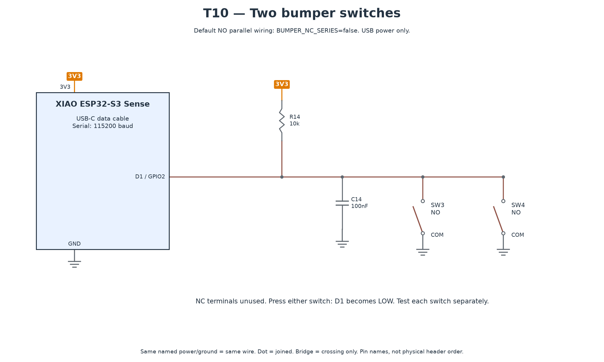

# T10 — Both bumper switches

[All hardware tests](../README.md) · [Full robot circuit](../../../docs/CIRCUIT.md)

[Full-size PNG](circuit.png) · [Zoomable SVG](circuit.svg)

**Parts:** XIAO, two microswitches, R14 10 kΩ, C14 100 nF, USB cable. Use each switch's **NO** and **COM** contacts in parallel; leave NC unused. Set `BUMPER_NC_SERIES=false` for this diagram.

1. Upload `T10_bumper.ino`; open Serial Monitor at 115200.
2. Press and release the left switch, then the right; test each independently.

**Pass:** idle reads HIGH; every press produces one `PRESSED` and every release returns to idle. This diagnostic reports events; full-robot motor stopping is checked during commissioning.

If idle is LOW, check NO/NC selection and R14. For repeated events, inspect the switch, connections and C14. If you deliberately choose NC series wiring, change both this sketch and main firmware polarity and follow the alternative in [hardware](../../../docs/HARDWARE.md).
