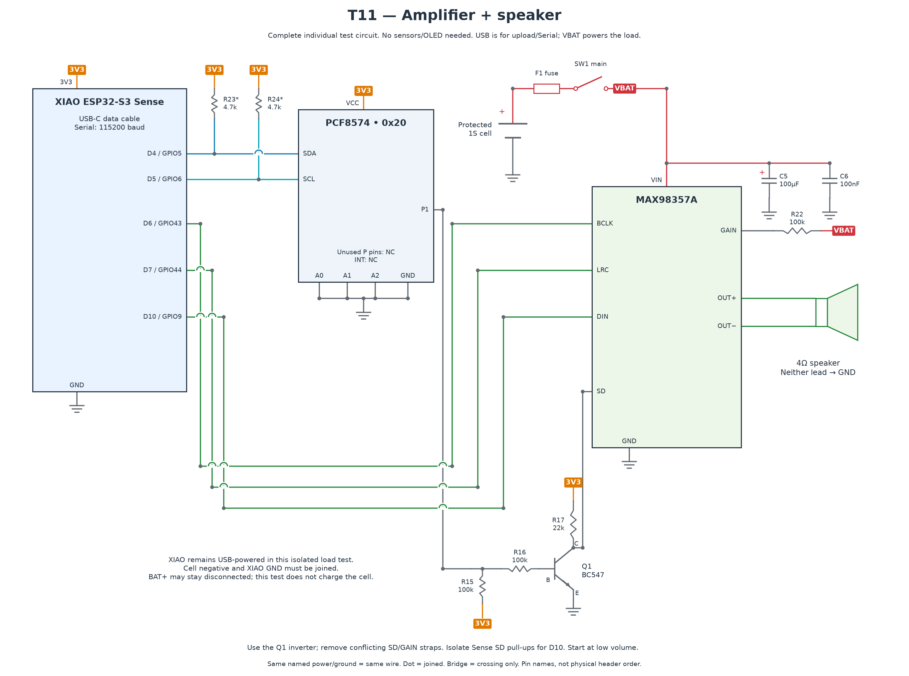

# T11 — Amplifier and speaker

[All hardware tests](../README.md) · [Full robot circuit](../../../docs/CIRCUIT.md)

[Full-size PNG](circuit.png) · [Zoomable SVG](circuit.svg)

**Parts:** XIAO, PCF8574, MAX98357A, Q1 BC547, R15/R16/R22 100 kΩ, R17 22 kΩ, C5 100 µF, C6 100 nF, 4 Ω speaker, protected 1S cell, F1, SW1 and USB cable. T07 must pass first.

The diagram includes the entire amp enable circuit. USB powers the XIAO; the battery powers the amp. Join grounds; BAT+ can remain disconnected. BCLK → D6, LRC → D7, DIN → D10. Isolate the Sense SD pull-up affecting D10 and remove conflicting amplifier SD/GAIN straps per [hardware](../../../docs/HARDWARE.md). Connect the speaker only between OUT+ and OUT−; neither lead goes to GND.

1. Wire with power off, checking Q1 pinout and C5 polarity. Keep motor power isolated if testing on the assembled robot.
2. Upload `T11_speaker.ino`, open Serial Monitor at 115200, then power the amplifier. A quiet tone is attempted at startup.
3. Press `t` for a one-second 440 Hz tone and `c` for a chime. `+` / `-` adjust volume; start at 10% and stay within the speaker's power rating.
4. Measure SD during playback and idle, supply current and temperature during repeated sounds.

**Pass:** clear tone/chime, shutdown between sounds, no persistent buzz, resets or excessive heating. Check measured temperature against the fitted parts' limits; do not use touching the powered chip as the test.

If silent, check battery, SD enable voltage and I²S pins. If distorted, lower volume and check supply sag. Complete firmware speech and reset behavior still require the full-robot tests.
