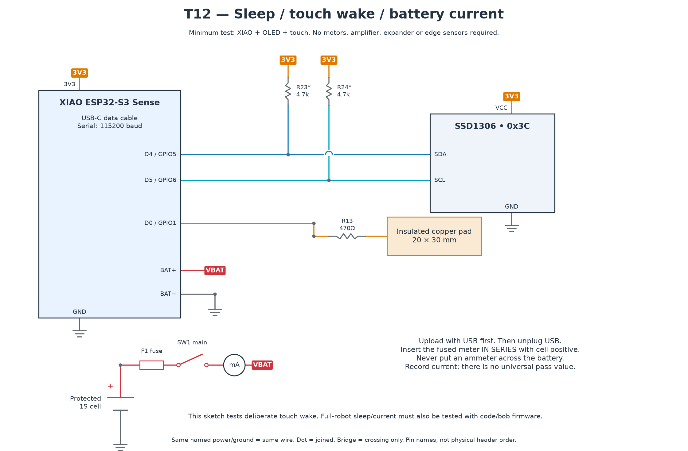

# T12 — Sleep and touch wake

[All hardware tests](../README.md) · [Full robot circuit](../../../docs/CIRCUIT.md)

[Full-size PNG](circuit.png) · [Zoomable SVG](circuit.svg)

**Parts:** XIAO Sense, SSD1306 OLED, touch pad and R13 470 Ω, protected 1S cell, F1, SW1, USB cable and fused multimeter. This is a minimal sleep fixture, not a measurement of the fully assembled robot.

1. Copy a validated `TOUCH_WAKE_DELTA` from T05 into `T12_sleep_wake.ino`. Upload over USB first.
2. Disconnect USB and switch off. Insert the meter **in series** with battery positive as drawn; choose a current range that can handle startup. Never put a current meter across the cell.
3. Switch on. Watch the 20-second OLED countdown; record awake and asleep current in the [inventory](../../../docs/INVENTORY.md).
4. Speech should not wake it. A deliberate pad touch should wake it and show `Hello!`; repeat several times.

**Pass:** reliable deliberate touch wake, no spontaneous wakes, and measured current recorded. There is no universal sleep-current value for every Sense-board revision.

This sketch does not put all camera/sensor hardware into its production sleep state. Repeat current and wake testing with the complete robot and `code/bob` firmware before estimating battery life. If wake is unreliable, repeat touch calibration in the final enclosure.
