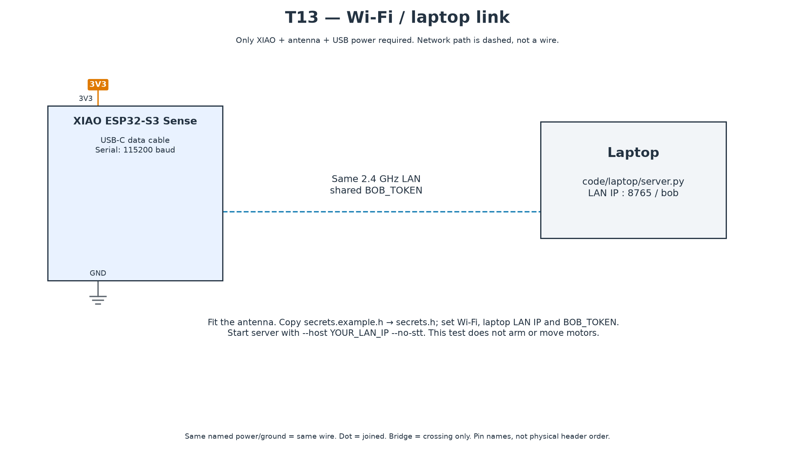

# T13 — Wi-Fi and laptop link

[All hardware tests](../README.md) · [Full robot circuit](../../../docs/CIRCUIT.md)



[Full-size PNG](circuit.png) · [Zoomable SVG](circuit.svg)

**Parts:** XIAO Sense, antenna, USB cable, laptop and a shared 2.4 GHz LAN. The dashed network path is wireless; no jumper wire or external sensor is needed.

1. Install the laptop dependencies using [setup](../../README.md). From the repository root, activate your Python environment and start:

```sh
export BOB_TOKEN='your-generated-shared-token'
python code/laptop/server.py --host YOUR_LAN_IP --no-stt
```

On PowerShell use `$env:BOB_TOKEN='your-generated-shared-token'`. Replace `YOUR_LAN_IP` with the laptop's Wi-Fi IPv4 address; `localhost` cannot be reached by the robot.

2. Copy this folder's `secrets.example.h` to `secrets.h`. Set Wi-Fi, laptop IP and the same `BOB_TOKEN`. Keep that file private.
3. Upload `T13_wifi_link.ino`, open Serial Monitor at 115200. Wait for `WebSocket connected. PASS step 1.`
4. In the laptop server console type `show Hello|from laptop`. Look for `PASS step 2: a laptop message arrived.`

**Pass:** both messages appear and the connection remains stable at the intended desk position. This test checks authenticated transport; it does not display the message on an OLED or arm/move motors.

If Wi-Fi succeeds but WebSocket fails, check LAN IP, matching token, port 8765 and device isolation. Allow the server only on the intended private network. See [laptop commands](../../laptop/README.md) for full-firmware use.
