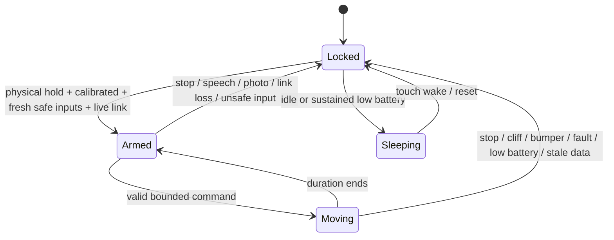

# Firmware, laptop and protocol

## Firmware ownership

| Module | Responsibility |
| --- | --- |
| `control.h` | Platform-independent permission policy, rollover-safe intervals, lease and edge filter |
| `safety.cpp` | Priority-3 task; owns motor starts; reads safety inputs; enforces gates and queues events |
| `motion.cpp` | Serializes PWM, rejects overlap, checks setup failures, independently enforces deadlines |
| `sensors.cpp` | Checked ADS1115 single shots; one battery conversion per cycle; A0–A2 unused |
| `pcf.cpp` / `bus.cpp` | ACK-based output latch and shared, bounded I²C access |
| `edges.cpp` | Three selected-family ToF devices behind TCA9548A; identity, channel, status and acquisition-age checks |
| `audio.cpp` / `camera.cpp` | Bounded audio, echo-tail drain, still JPEGs and peripheral shutdown |
| `display.cpp` | Render off-bus, transmit at most 64 bytes per loop |
| `net.cpp` | Wi-Fi retry, WebSocket authentication, bounds, sequence checks, heartbeat |
| `power.cpp` | Touch and acknowledged sleep shutdown |
| `diagnostics.cpp` / `wiring.cpp` | Status JSON, non-moving USB tools, boot diagnostics |
| `bob.ino` | Setup and application dispatch; no direct motor PWM |

The state mutex serializes stop/unlock/speech/patrol/queue operations with validation and driver wake. The motor mutex serializes PWM and timer operations. Lock order is state → bus or motor; bus functions never request the state mutex. No I²C operation runs from the motor timer. The sensor acquisition occurs outside the state lock. Stop clears the queue and relocks; an old command cannot resume after a stop. Sleep requests stop first and wait for an acknowledgment before shutting down peripherals.

A normal duration ending leaves permission available for the next command. All explicit stops require another valid physical hold. `patrol on` generates only short forward steps separated by a pause. Speech and photos stop patrol; they do not restart it automatically.

## Timing and failure behavior

- I²C 100 kHz; bus acquisition up to 15 ms, transaction timeout 10 ms. Conversion polling checks its 12 ms deadline between bounded transactions; a failed transaction can add its own timeout to that bound.
- Sensor lease: oldest acquisition start timestamp, maximum age 120 ms. Independent 5 ms motor callback stops an expired lease or pressed bumper. These are software scheduling targets, not measured physical stopping latency.
- Command: duty ≤40%, forward ≤400 ms, pivot ≤250 ms; queued request age <200 ms. Active motion cannot be extended by another request. No reverse.
- Three distinct measurements inside the calibrated desk band with 3 mm inward margin acquire table presence. Outside-band or invalid readings clear immediately. Cached readings do not count again. Low voltage or invalid ADC data stops immediately; no smoothing can hide sag.
- Link: laptop sends authenticated JSON ping every 400 ms; safety expires permission at 1500 ms without one. Camera/audio/network stalls cannot bypass motor deadlines.
- LEDC: motor channels 0–3 use the core's first matching timer; initialization happens before camera channel 7/timer 3. APB clock is selected for compatibility. Core version is pinned; revalidate scope traces when changing it.
- Resource failures keep motion disabled. Missing edge modules or mux prevent motion; non-moving diagnostics remain available. Safety-critical startup failures require reset after repair.
- Stop is **coast** (all inputs low), then driver sleep. Measure actual travel after cutoff.

## Wire protocol v3

Firmware connects to `ws://SERVER_HOST:8765/bob` with `Authorization: Bearer <BOB_TOKEN>`. Configure the same random token of at least 32 characters on both sides. The server accepts one robot. Real secrets are never copied by the normal verification build.

Every laptop text frame includes `token` and strictly increasing positive `seq`. Reconnection resets sequence and locks motion. A valid `ping` authenticates the server session and refreshes the lease. JSON ≤1024 bytes and nesting ≤4 on firmware; PCM payload ≤4096 bytes and even length. The pinned WebSocket library additionally caps inbound allocation at 15 KiB before application filtering. Fragmented commands are refused. Binary playback is accepted only after a valid authenticated ping.

| Laptop → robot type | Payload / action |
| --- | --- |
| `ping` | Lease renewal; robot sends `pong` |
| `status` | Immediate status reply |
| `stop` | Stop, cancel queue and patrol, relock |
| `move` | `dir`: forward / pivot_left / pivot_right / stop; integer `duty`, positive integer `ms` |
| `patrol` | Boolean `on`; requires physical arming |
| `show` | `line1`, `line2`, optional `ms` capped at 60000 |
| `state`, `listen` | Display mood / Boolean listening state |
| `say_start`, `say_end` | Stop/lock for speech; end amplifier playback |
| `photo` | Stop/lock and return JPEG |
| `sleep`, `keep_awake` | Acknowledged sleep / activity update |

Binary: `A` + signed 16-bit little-endian 16 kHz mono PCM to laptop; `I` + JPEG to laptop (≤512 KiB); `P` + same PCM format to robot. A photo is not used as a navigation safety input.

Robot text: `hello`, `wiring`, `event`, `status`, `pong`. Status includes `battery_valid`, `battery_v`, `battery_low`, `calibrated`, `table[3]`, `edge_mm[3]`, `edge_valid[3]`, `edge_status[3]`, `edge_sensor`, `sensors_ok`, `bumper`, `fault`, `unlocked`, `patrol`, `moving`, `link_ok`, `stop_reason`, `cycle_ms`, `max_cycle_ms`, `heap_free`, `uptime_ms`, and Wi-Fi RSSI. Unknown battery/range values are not proof of safe hardware. Events are a bounded diagnostic queue; stop enforcement does not rely on event delivery.

## Laptop

`speech.py` owns PCM conversion, segmentation and optional synthesis/transcription. `reminders.py` owns SQLite and time parsing. `protocol.py` validates frames and commands. `transport.py` owns authentication, heartbeat, one connection and cleanup. `server.py` owns user commands, photos and reminder behavior.

At most eight command tasks are admitted. One transcription runs at a time; pending audio is dropped instead of accumulating work. TTS subprocesses are killed on timeout/cancellation. OCR uses a worker thread and a subprocess timeout. Speech, photo requests and outbound JSON ordering have separate locks. A context-bound session check prevents delayed work from commanding a replacement connection. Console `stop` is handled immediately and cancels active command work.

The user-visible features retained are touch wake/arm/stop, OLED moods and text, microphone streaming, local wake phrase recognition, speech playback, still photos, optional OCR, reminders, short forward/pivot moves and supervised forward patrol. No general-purpose LLM was configured in the original server; unrecognized speech remains a spoken echo rather than invented AI functionality.

## ToF acquisition

The selected circuit and default build use `BOB_EDGE_SENSOR=530` (three VL53L0X modules). The legacy `BOB_EDGE_SENSOR=6180` uses Pololu VL6180X 1.4.0; `530` uses VL53L0X 1.3.1. Only the selected driver is linked. All three physical modules must match. The mux is 0x70 and each branch device is 0x29. Each access holds the bus lock across channel selection/read-back, sensor transactions and channel isolation.

VL6180X uses 16-bit register addresses, 30 ms maximum convergence and a 50 ms period; accepted native status is 0, range ≤100 mm. VL53L0X uses 8-bit register addresses, a 33 ms timing budget and 50 ms period; accepted device status is 11, 0 < range <2000 mm. Runtime reads and interrupt clears check ACK and byte count. These checks supplement, not replace, physical surface validation.

Startup stops any ranging retained across an MCU reset, clears interrupts and discards the first frame. The previous start/interrupt-clear time conservatively dates each completed frame. This prevents an old latched ready bit from receiving a fresh timestamp when polled late. Each sensor's last accepted frame ages independently. The safety snapshot uses the oldest acquisition; any invalid sensor blocks all motion. Native status is reported in `edge_status`; 250 means bus/mux/init failure, 251 means stale/not ready. Sleep stops each selected channel's continuous ranging and deselects the mux.

There is no forward ToF adapter or reflective-LED branch. Bumpers stop on contact; no automatic obstacle detour is implemented.
