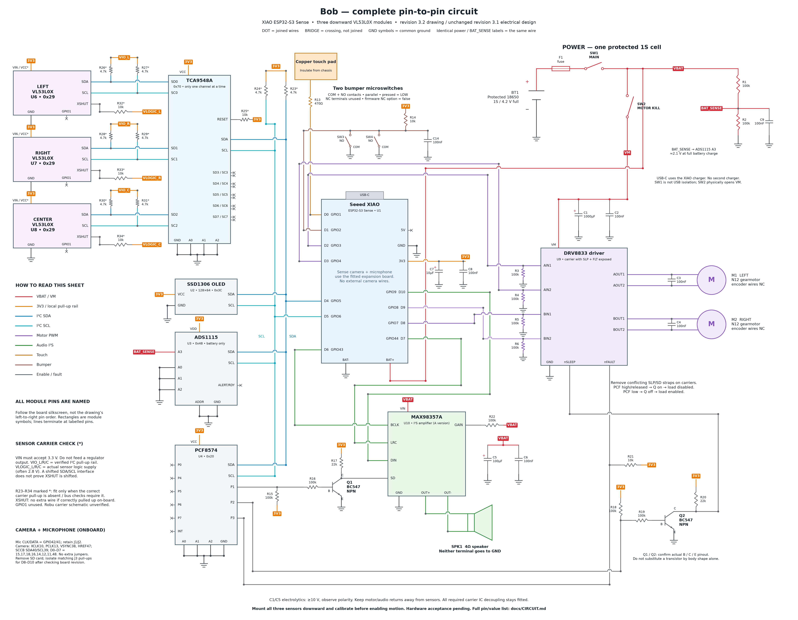

# Complete pin-to-pin circuit — drawing revision 3.2 / three VL53L0X

This is the complete **external module wiring** for the selected robot, including every added resistor and capacitor. Camera, microphone, regulators, charging and driver support components already fitted to their respective boards remain on those boards. It is not a bare-IC PCB fabrication schematic. Match module pin labels rather than header positions; Robu's exact carrier schematic and supplied board revision could not be verified from the listing.

**Start with the full schematic below.** It follows the supplied reference layout: continuous signal wires to labelled pins, individual external component symbols, connection dots and bridges for crossings. The electrical design and VL53L0X firmware selection remain revision 3.1; revision 3.2 changes the drawing and its verification.

| View | PNG | Zoomable SVG |
| --- | --- | --- |
| **Full circuit — every external component on one sheet** | [Full-resolution PNG](../images/bob-wiring.png) | [Full vector schematic](../images/bob-wiring.svg) |
| Detail crop: power, touch, bumpers, controller and motor supply | [Power/controller](../images/bob-circuit-1.png) | [SVG](../images/bob-circuit-1.svg) |
| Detail crop: three VL53L0X sensors, mux, OLED, ADC and expander | [Sensors/shared bus](../images/bob-circuit-2.png) | [SVG](../images/bob-circuit-2.svg) |
| Detail crop: motor, audio and enable circuits | [Motors/audio](../images/bob-circuit-3.png) | [SVG](../images/bob-circuit-3.svg) |

The master PNG is **5760 × 4480 pixels**. Use the SVG to zoom without blurring; the inline preview reduces the whole sheet. Detail images are crops of that same schematic, so wires at a crop boundary continue on the full sheet. They are not separate circuit designs.

U1=XIAO, U2=OLED, U3=ADS1115, U4=PCF8574, U5=TCA9548A, U6/U7/U8=left/right/center VL53L0X, U9=DRV8833 and U10=MAX98357A. SW3/SW4 are the bumper switches. Component names match the tables below.

Identical **power and BAT_SENSE labels** are electrically joined; these short named connections avoid running power wires across every device. Sensor control and motor/audio signal wires are drawn continuously on the full sheet. A connection dot marks a junction. `NC` means leave unconnected. `3V3` means the XIAO's regulated output; `VBAT` is the fused/switched cell rail; `VM` is downstream of the motor kill switch. All GND labels share the same ground. Sensor bus rails `VIO_L/R/C` and sensor logic rails `VLOGIC_L/R/C` depend on the carrier; they are not additional XIAO outputs. A level-shifted bus can use 3V3 while an unshifted XSHUT still needs the sensor logic rail.

## 1. Battery and power — connect these first with USB and cell removed

| From | To | Component / purpose |
| --- | --- | --- |
| Protected 1S cell positive | F1 input | Fuse immediately beside cell; choose after current measurements |
| F1 output | SW1 input | Main switch |
| SW1 output (`VBAT`) | XIAO BAT+, amplifier VIN, R1 upper end, SW2 input | Never connect VBAT to 3V3 |
| SW2 output (`VM`) | DRV8833 VM, C1+, C2 | Physical motor kill; use DC-rated switch |
| Cell negative | XIAO BAT−, XIAO GND and all module GNDs | Common ground; short power returns |
| XIAO 3V3 | OLED VCC, ADS1115 VDD, PCF8574 VCC, TCA9548A VCC, three compatible VL53L0X VIN/VCC inputs | Verify current budget and sensor input compatibility |
| XIAO 5V | NC | USB powers/charges through the board's USB connector; no sensor wiring here |
| XIAO USB-C | USB data/power cable when needed | Keep SW2 open during programming/charging; SW1 is not total isolation with USB present |

Use the XIAO battery pads according to their actual +/− markings. Only a protected **1S, 4.2 V full-charge cell** fits this circuit. Keep the existing XIAO charger; do not parallel another charger. Select cell/fuse/wire ratings from measured startup, stall and combined loads. See [power checks](HARDWARE.md#power-and-battery).

## 2. XIAO header and built-in devices

| XIAO pin | ESP32 GPIO | Net / destination |
| --- | ---: | --- |
| D0 | 1 | `TOUCH` → R13 470 Ω → insulated touch pad |
| D1 | 2 | `BUMPER` → R14 10 kΩ to 3V3; C14 100 nF to GND; two NO bumper switches in parallel to GND |
| D2 | 3 | `AIN1` → DRV8833 AIN1; R3 100 kΩ to GND |
| D3 | 4 | `AIN2` → DRV8833 AIN2; R4 100 kΩ to GND |
| D4 | 5 | `SDA` → all four upstream I²C devices below |
| D5 | 6 | `SCL` → all four upstream I²C devices below |
| D6 | 43 | `BCLK` → MAX98357A BCLK |
| D7 | 44 | `LRC` → MAX98357A LRC / LRCLK / WS |
| D8 | 7 | `BIN1` → DRV8833 BIN1; R5 100 kΩ to GND |
| D9 | 8 | `BIN2` → DRV8833 BIN2; R6 100 kΩ to GND |
| D10 | 9 | `DIN` → MAX98357A DIN |
| Sense microphone | 42 / 41 | Built-in PDM clock / data; keep microphone jumpers J1/J2 intact |
| Sense camera | 10 / 13 / 38 / 47 | Built-in XCLK / PCLK / VSYNC / HREF |
| Sense camera | 40 / 39 | Built-in camera SCCB SDA / SCL; separate from D4/D5 |
| Sense camera | 15,17,18,16,14,12,11,48 | Built-in camera D0–D7, in that order |

Camera ribbon and microphone use the Sense board connectors/traces, **no external jumper wires**. Match [Seeed's pinout and J3 instructions](https://wiki.seeedstudio.com/xiao_esp32s3_pin_multiplexing/) to the board revision: remove the SD card, isolate the relevant SD pull-ups for D8–D10 and confirm continuity. Do not cut J1/J2. No extra GPIO is consumed by the three sensors.

## 3. Shared bus and three isolated sensor branches

Bus speed is **100 kHz**. Every upstream device uses common `SDA`, `SCL`, `3V3` and `GND`.

| Module | Address (7-bit) | Other connections |
| --- | --- | --- |
| SSD1306 4-pin OLED | 0x3C | VCC=3V3, GND; no external reset on this 4-pin carrier |
| ADS1115 | 0x48 | ADDR=GND; A0,A1,A2=GND; A3=`BAT_SENSE`; ALERT/RDY=NC |
| PCF8574 | 0x20 | A0,A1,A2=GND; INT=NC; P1/P2/P3 below; P0/P4–P7=NC, firmware releases high |
| TCA9548A | 0x70 | A0,A1,A2=GND; RESET via R25 10 kΩ to 3V3 if missing on carrier; channels 3–7 NC |

A PCF8574A has address 0x38 instead: change `PCF_ADDR` before use. No address change is needed on the three VL53L0X modules because they are on separate mux branches. The sensor's 7-bit 0x29 is equivalent to ST's 8-bit write address 0x52; Arduino uses **0x29**.

| Printed sensor pin | Left VL53L0X | Right VL53L0X | Center VL53L0X |
| --- | --- | --- | --- |
| VIN / VCC (carrier power input) | 3V3* | 3V3* | 3V3* |
| GND | GND | GND | GND |
| SDA | TCA SD0 | TCA SD1 | TCA SD2 |
| SCL | TCA SC0 | TCA SC1 | TCA SC2 |
| XSHUT / XSD / SHDN, if exposed | Carrier pull-up, or R32 10 kΩ → VLOGIC_L* | Carrier pull-up, or R33 10 kΩ → VLOGIC_R* | Carrier pull-up, or R34 10 kΩ → VLOGIC_C* |
| GPIO1 / INT / GPIO, if exposed | NC | NC | NC |

**\* Carrier checks:** 3V3 connects only to a confirmed compatible VIN/VCC input. A regulator output is not a power input. The exact delivered header order and regulator/level-shifter circuit are unverified; identify by silkscreen and carrier documentation. XSHUT must be held high, not floating: leaving its header unwired is correct only if an onboard pull-up already does this. Use the actual sensor logic supply for an unshifted XSHUT (often regulated 2.8 V). Do not tie it blindly to 3V3 or 5V.

Keep onboard SDA/SCL pull-ups when suitable. R23/R24 are optional upstream pull-ups to 3V3. R26/R27, R28/R29 and R30/R31 are optional SDA/SCL branch pull-ups to the **verified carrier interface rail VIO_L/R/C**. With host-side level shifting this can be 3V3; with an unshifted 2.8 V interface it must be that 2.8 V rail. The [TCA9548A](https://www.ti.com/lit/ds/symlink/tca9548a.pdf) permits separate segment pull-up rails. It supplies no regulated rail. Do not add parallel resistors until existing pull-ups and rise time are checked. An upstream equivalent near 2.2–4.7 kΩ is a starting point at 100 kHz; validate with each selected branch attached.

Only one channel is enabled at a time. **Do not join SD0/SD1/SD2 or SC0/SC1/SC2.** GPIO1 is intentionally unused because firmware polls the sensors. See [ST's application schematic](https://www.st.com/resource/en/datasheet/vl53l0x.pdf) for XSHUT and interface requirements. Mount all three facing down, initially around 60 mm above the desk, then measure and calibrate. Default 40–80 mm bands do not authorize motion.

## 4. Motors and enable circuits

| Module terminal | Connection |
| --- | --- |
| DRV8833 VM / VIN | `VM` after SW2; C1/C2 to GND nearby |
| DRV8833 GND | GND, with short high-current return |
| AIN1 / AIN2 | D2 / D3, each with external pulldown R3/R4 |
| BIN1 / BIN2 | D8 / D9, each with external pulldown R5/R6 |
| AOUT1 / AOUT2 | Left motor terminals; C3 across motor tabs |
| BOUT1 / BOUT2 | Right motor terminals; C4 across motor tabs |
| nSLEEP / SLP | `DRIVER_EN` = Q2 collector + R20 to 3V3 |
| nFAULT / FLT | `FAULT` = PCF P3 + R21 10 kΩ to 3V3 |
| AISEN / BISEN if exposed | Retain carrier sense resistors to GND; must not float; follow carrier schematic |
| Charge pump / internal regulator support | Already populated on a complete DRV8833 carrier; do not use a bare IC with only this module wiring |
| Motor encoder wires | Insulated individually, NC |

Use a carrier exposing both nSLEEP and nFAULT, and remove conflicting enable straps. A hard-tied nSLEEP cannot be disabled by Q2 safely. Confirm actual driver package, current/thermal capacity and sense-resistor implementation. See [TI DRV8833](https://www.ti.com/lit/ds/symlink/drv8833.pdf).

Two identical NPN inverter circuits are required:

| Connection | Amplifier inverter | Driver inverter |
| --- | --- | --- |
| PCF output (`AMP_CTL` / `DRV_CTL`) | P1 | P2 |
| Output pull-up to 3V3 | R15 100 kΩ | R18 100 kΩ |
| Output to transistor base | R16 100 kΩ → Q1 base | R19 100 kΩ → Q2 base |
| Transistor emitter | Q1 emitter → GND | Q2 emitter → GND |
| Transistor collector | Q1 collector → `AMP_EN` / amp SD | Q2 collector → `DRIVER_EN` / driver nSLEEP |
| Collector pull-up to 3V3 | R17 22 kΩ | R20 22 kΩ |

Q1/Q2 are BC547 NPN; verify B/C/E on the exact manufacturer's part. PCF output **released/high → transistor on → enable low → device off**. PCF output **low → transistor off → enable high → device on**. Remove conflicting SD/nSLEEP carrier pull-ups/hard straps and measure both logic states; driver enable must reach ≥2.5 V. PCF latches may retain state during MCU reset, so the four motor input pulldowns are still mandatory.

## 5. Audio, touch and bumper wiring

| Part | Connection |
| --- | --- |
| MAX98357A VIN / GND | VBAT / GND, C5/C6 nearby |
| BCLK / LRC / DIN | D6 / D7 / D10 |
| SD / SD_MODE | `AMP_EN` from Q1 collector/R17 |
| GAIN | R22 100 kΩ to VIN (VBAT); check/remove conflicting carrier gain straps |
| OUT+ / OUT− | Two speaker terminals; **neither connects to GND** |
| Touch pad | R13 470 Ω to D0; insulated copper pad, no fixed ground connection |
| Left bumper | COM to GND, NO to D1; NC unused |
| Right bumper | COM to GND, NO to D1; NC unused |

Default `BUMPER_NC_SERIES=false` matches these parallel NO switches. Optional NC wiring requires COM/NC contacts in series from D1 to GND and setting the option true in both main firmware and T10. R14/C14 remain unchanged. Do not mix the two topologies. Use MAX98357**A** for the current I²S format. Verify speaker power and heating with the actual amplifier/module; see [MAX98357A](https://www.analog.com/media/en/technical-documentation/data-sheets/MAX98357A-MAX98357B.pdf).

## 6. All external passive components

| Ref | Value | Terminal 1 / positive | Terminal 2 / negative |
| --- | --- | --- | --- |
| R1 | 100 kΩ | VBAT | BAT_SENSE |
| R2 | 100 kΩ | BAT_SENSE | GND |
| R3 / R4 | 100 kΩ each | AIN1 / AIN2 respectively | GND |
| R5 / R6 | 100 kΩ each | BIN1 / BIN2 respectively | GND |
| R13 | 470 Ω | D0 | Touch pad |
| R14 | 10 kΩ | 3V3 | BUMPER |
| R15 / R18 | 100 kΩ each | 3V3 | AMP_CTL / DRV_CTL respectively |
| R16 / R19 | 100 kΩ each | AMP_CTL / DRV_CTL | Q1 base / Q2 base respectively |
| R17 / R20 | 22 kΩ each | 3V3 | AMP_EN / DRIVER_EN respectively |
| R21 | 10 kΩ | 3V3 | FAULT |
| R22 | 100 kΩ | VBAT | Amplifier GAIN |
| R23 / R24 | 4.7 kΩ starting value, only if needed | 3V3 | SDA / SCL respectively |
| R25 | 10 kΩ, if missing on carrier | 3V3 | Mux RESET |
| R26 / R27 | 4.7 kΩ starting value, only if needed | VIO_L | SD0 / SC0 respectively |
| R28 / R29 | 4.7 kΩ starting value, only if needed | VIO_R | SD1 / SC1 respectively |
| R30 / R31 | 4.7 kΩ starting value, only if needed | VIO_C | SD2 / SC2 respectively |
| R32 / R33 / R34 | 10 kΩ, only if missing | Respective sensor logic rail | Left / right / center XSHUT respectively |
| C1 | 1000 µF, ≥10 V | VM | GND |
| C2 | 100 nF ceramic | VM | GND |
| C3 | 100 nF ceramic | Left motor terminal 1 | Left motor terminal 2 |
| C4 | 100 nF ceramic | Right motor terminal 1 | Right motor terminal 2 |
| C5 | 100 µF, ≥10 V | VBAT at amp | GND |
| C6 | 100 nF ceramic | VBAT at amp | GND |
| C7 | 10 µF | 3V3 | GND |
| C8 | 100 nF ceramic | 3V3 | GND |
| C9 | 100 nF ceramic | BAT_SENSE / ADS A3 | GND |
| C14 | 100 nF ceramic | BUMPER / D1 | GND |

R7–R12 and C10–C13 were removed with the analog edge circuit; numbering gaps are intentional. Add local 100 nF decoupling on any carrier that lacks it; retain manufacturer-required onboard bulk/IC capacitors. Electrolytics require correct polarity. `BAT_SENSE` is approximately half VBAT (2.1 V at full charge); it goes to **ADS1115 A3**, not a XIAO pin.

Regenerate the master schematic and its detail crops with `python tools/draw_circuit.py` (Matplotlib required). The generator checks every drawn component terminal for a wire on the correct named net, rejects different-net wire overlaps/endpoints, and marks crossings automatically. The generated [terminal netlist](circuit-netlist.json) allows each component connection to be traced by reference. These checks verify the drawing, not the delivered carrier or electrical performance. Before wiring, complete [inventory](INVENTORY.md); before motion, follow [power checks](HARDWARE.md) and [commissioning](TESTING.md). Physical voltage/current, optical performance and stopping distance remain unverified.
